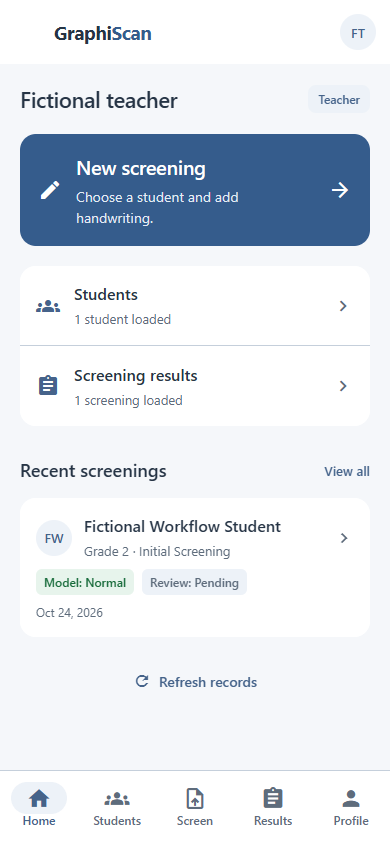
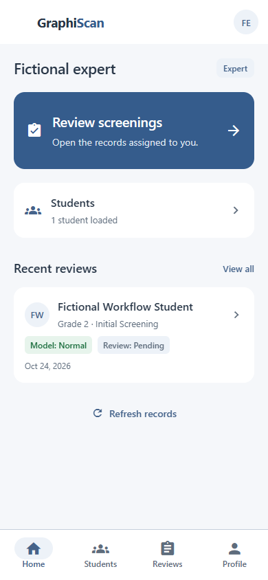
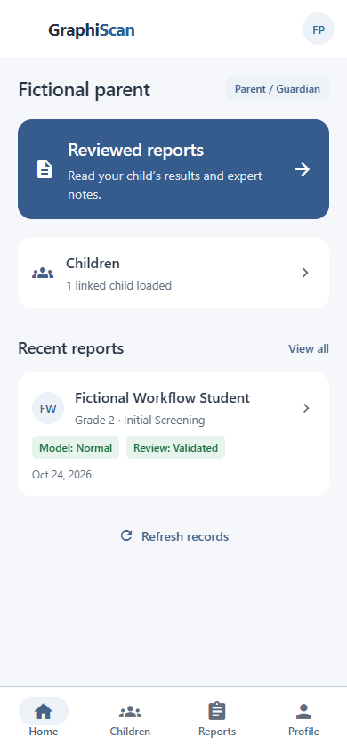
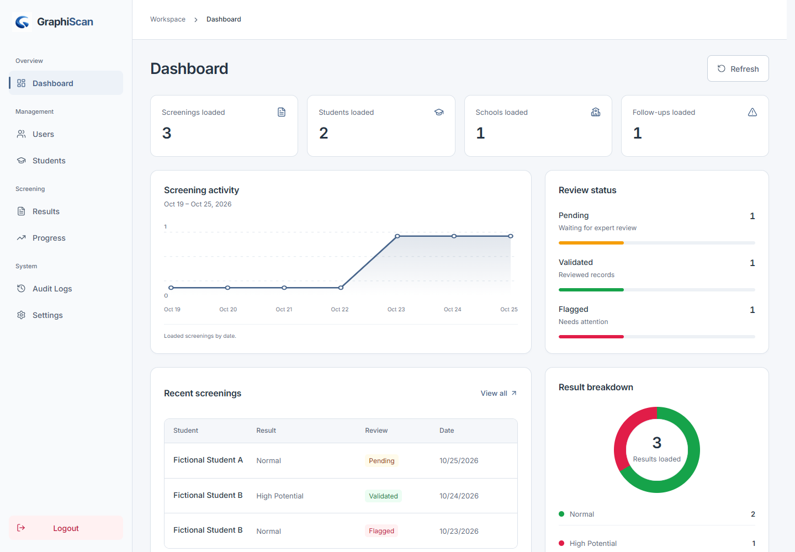



  
  <h1>GraphiScan</h1>
  
<strong>Handwriting screening, supported by expert review.</strong>

  
A capstone project connecting teachers, experts, and families through a shared screening workflow.

  
<a href="https://graphiscan.site/">Visit the website</a> · <a href="https://graphiscan.site/download/">Download for Android</a> · <a href="#documentation">Documentation</a>

---

GraphiScan explores how image classification can assist with screening handwriting for possible dysgraphia-related difficulties. Teachers submit handwriting samples, experts review the results, and authorized families can access information relevant to their child.

> **A screening aid, not a diagnosis.** Model outputs are preliminary and require expert interpretation. They do not replace a clinical assessment.

## A look at GraphiScan

<table>
  <tr>
    <td align="center"><strong>Teacher</strong> Start a screening and follow student results.</td>
    <td align="center"><strong>Expert</strong> Review assigned screenings and add feedback.</td>
    <td align="center"><strong>Parent / guardian</strong> Access information for linked children.</td>
  </tr>
  <tr>
    <td></td>
    <td></td>
    <td></td>
  </tr>
</table>

### Administration workspace

The web-based admin workspace brings account management, student records, screening activity, and audit information together for authorized administrators.

These screenshots use fictional records and show earlier interface states; the current application may look different.

## How it works

1. **Submit** — A teacher selects a student and submits a handwriting image for screening.
2. **Screen** — The selected image-classification model produces a preliminary **Normal** or **High Potential** output.
3. **Review** — An authorized expert reviews the result and can provide feedback and recommendations.
4. **Follow up** — Authorized users can access relevant reports and screening history according to their role and record permissions.

## Built with

| Area | Technology | Source |
| --- | --- | --- |
| Android mobile app | React Native, Expo | [Mobile app](graphiscan/mobile-app/) |
| Admin web app | Vue 3 | [Admin web](graphiscan/admin-web/) |
| API and inference | Python, Flask, LiteRT | [Application](graphiscan/) |
| Model training | TensorFlow / Keras | [Model evidence](graphiscan/api/MODEL_EVIDENCE.md) |
| Identity and data | Supabase Auth, PostgreSQL, private Storage | [Database](graphiscan/db/) |
| Public website | Web frontend | [Landing site](graphiscan/landing-web/) |

The repository also retains a legacy Flask/MySQL and Vue prototype in `graphiscan/user-app`.

## Project status

Android version **1.0.5** was published on 13 November 2026. ResNet50 was the default selectable model when last verified on that date. Physical-device and authenticated end-to-end acceptance checks remain incomplete. See [KNOWLEDGE.md](KNOWLEDGE.md) and [CHANGELOG.md](CHANGELOG.md) for dated evidence and limitations.

## Getting started

Start with the instructions for the component you want to work on:

- [Mobile app](graphiscan/mobile-app/README.md) · [Admin web](graphiscan/admin-web/README.md) · [Landing site](graphiscan/landing-web/README.md)
- [API documentation](graphiscan/api/README.md) · [Database migration notes](graphiscan/db/MIGRATION_NOTES.md)

Some component documents include historical checkpoints. Consult [KNOWLEDGE.md](KNOWLEDGE.md) before applying migrations or deployment instructions; local Python environments may need to be recreated. Private configuration and deployed model binaries are supplied separately. Use example configuration files as templates and obtain access through the project maintainers.

## Documentation

| Guide | Description |
| --- | --- |
| [System flow](SYSTEM_FLOW.md) | A concise walkthrough of the application and screening flow |
| [System map](KNOWLEDGE.md) | Architecture, current state, and verification notes |
| [API contract](API_CONTRACT.md) | API behavior and data semantics |
| [Project plan](PROJECT_PLAN.md) and [handoff](RESUME.md) | Priorities, decisions, and open work |
| [Manuscript reviews](docs/manuscript/README.md) | Research and defense revision materials |
| [Changelog](CHANGELOG.md) | Dated changes and verification history |

## Privacy and responsible use

Student records and handwriting images require restricted access. Never commit credentials, signing keys, private configuration, student data, or handwriting samples. Screening results are not medical conclusions and should be interpreted with expert review.
