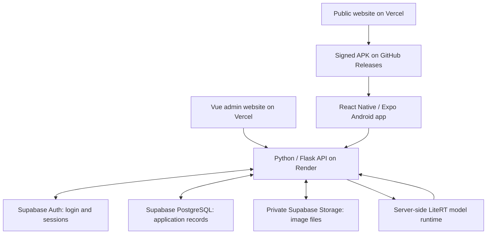

# GraphiScan: simple system and model flow

Updated: 7 November 2026.

GraphiScan lets a teacher submit a student's handwriting image, runs a screening model on the server, and lets an authorized expert review the result. A linked parent can view a result after it is validated.

## 1. The stack: what each part does

| Part | Technology | Simple explanation |
| --- | --- | --- |
| Public website | HTML, CSS, TypeScript and Vite; hosted on Vercel | Explains GraphiScan and provides the Android APK download. |
| Admin website | Vue 3 and Vite; hosted on Vercel | Lets authorized administrators manage accounts, schools, assignments and records. |
| Mobile app | React Native, Expo and TypeScript | The installed Android app used by teachers, experts and parents. |
| Backend / API | Python, Flask and Gunicorn; hosted on Render | Receives requests, checks access, coordinates screening and returns results. |
| Authentication | Supabase Auth | Checks login credentials and issues session tokens. |
| Database | Supabase PostgreSQL | Stores structured records: profiles, students, schools, screenings, reviews, assignments and activity history. |
| File storage | Private Supabase Storage | Stores handwriting images. Private model artifacts are stored separately from student images. |
| Machine learning | TensorFlow/Keras for model preparation; LiteRT for the hosted model runtime | Trained image models analyze handwriting. The hosted runtime runs prepared model files without training again. |
| Source and APK release | GitHub | Stores source code and hosts the downloadable signed APK. |

**Frontend** means the screens people see and interact with. **Backend** means the server-side code that handles their requests. **API** means the interface through which the frontend asks the backend to do something.

## 2. How the parts connect



The public website provides the download; it does not receive student handwriting. The installed app and admin website communicate with the API using HTTPS. The API controls access to protected records and images. Server credentials stay on the server.

The APK contains the app interface and connects to the hosted API. The screening model runs on the server, so screening requires an internet connection.

## 3. The normal user flow

1. **Administrator sets up access.** An authorized administrator creates accounts and configures the relevant schools and assignments. Login details are handed over directly.
2. **User signs in.** The app sends the login request to the API. Supabase Auth checks the credentials; the API checks the user's current application profile and access.
3. **User completes required onboarding.** Mobile accounts must change their initial password when required and explicitly accept the current privacy notice before accessing normal features.
4. **Teacher selects a student.** The teacher sees students within their current ownership and school/grade scope. Student details show identity, school and linked parent before the user opens screening history.
5. **Teacher submits handwriting.** The teacher selects the student, image and available model. The API checks the teacher's access and the image, prepares it for inference, and runs the selected model.
6. **The system saves a screening.** The database records the result, model/version and relevant history; the handwriting image is kept in private storage. A new result awaits expert review.
7. **Expert reviews it.** An expert with the required current school/grade access examines the authorized record and image, then records a review, remarks, recommendations and follow-up information where applicable. The expert does not replace the original model output.
8. **Parent views a released result.** The parent must currently be linked to that child, and the result must currently be **Validated**. Pending or Flagged results are withheld from parent result/report/image access.
9. **Later screenings build history.** Further screenings remain separate dated records so authorized users can inspect the sequence. A changing model label alone does not prove clinical improvement.

The backend checks access on protected requests. Hiding a button in the frontend is not the security check.

## 4. What is a CNN?

**CNN means Convolutional Neural Network.** It is a type of machine-learning model designed to work with images.

Think of it as a series of learned image filters:

```text
Handwriting image
    -> early layers detect simple edges and strokes
    -> later layers combine them into more complex visual patterns
    -> final layers produce classification scores
```

During **training**, examples and their labels are used to adjust the model's internal numerical weights. During **inference**, the trained model uses those weights to score a new image. Uploading an image to GraphiScan performs inference; it does not retrain the model.

The model analyzes visual patterns in the image. It does not need to transcribe the handwriting into text to produce this screening classification.

## 5. Which models does GraphiScan use?

The current binary model catalogue supports these three CNN architectures:

| Model | What it is, simply |
| --- | --- |
| **MobileNetV2** | A compact CNN architecture designed to reduce computation. Its name does not mean GraphiScan runs it inside the phone; our inference runs on the server. |
| **EfficientNetB0** | The baseline EfficientNet architecture. It balances network depth, width and image resolution to use computation efficiently. |
| **ResNet50** | A 50-layer residual network. Its shortcut connections help information move through a deep network during training. |

These are three alternative architectures for the screening task. Selecting a model uses that model for the request; GraphiScan does not automatically combine all three into a voting result.

The current task has two output classes: **Normal** and **High Potential**. Older three-class experiments are separate and should not be presented as the current deployed classification task.

### How a label is chosen

The implemented decision rule reports **High Potential when its score is at least 0.75 (75%)**. Otherwise, it reports **Normal**. The model identity and decision rule belong to the recorded screening so historical results retain their meaning.

For example, a High Potential score of 60% still produces the label Normal under this rule. The model score is not a diagnosis or a proven clinical probability. The expert review is a separate recorded human decision.

An architecture name alone does not establish which model performs best for this project. That requires the project's evaluation results on the same task and dataset.

## 6. How code becomes the installed app and website

```text
Source changes -> Git commit -> Push to GitHub
    -> Vercel builds the public/admin websites
    -> Render is configured to deploy the backend from the repository

Mobile source -> Android native release build -> Sign with private release key
    -> Upload Graphiscan.apk to GitHub Releases
    -> Website download button links to that APK
    -> User downloads and installs it on Android
```

A source push does not automatically replace the APK already installed on phones. Mobile changes need a new applicable app release; users then install the update. Preserve the original private signing key for compatible Android updates.

iPhone installation needs a separate signed iOS build and distribution setup. TestFlight and registered-device distribution were discussed, but no iOS release has been built.

## 7. What is verified so far?

- The signed Android 1.0.1 APK is available through [the live download page](https://graphiscan.site/download/). The recorded release checks verified its signature, matching original signer and uploaded checksum, plus the live website's 1.0.1 download link. Emulator installation and launch were checked for the earlier 1.0.0 release.
- The website's blue download button and font loading were checked on all four live pages. Local checks also covered phone/desktop widths and font-download failure.
- Earlier records include a user-supplied successful hosted MobileNetV2 screening. This session did not repeat authenticated screening, expert review or parent release tests.
- The APK release still needs physical-phone and full authenticated workflow acceptance. Diagrammed/source-implemented behavior is not a claim that every step was exercised during the release check.

## Source references

- [Current handoff and verification](RESUME.md)
- [Hosted Flask application](graphiscan/hosted_api.py)
- [Mobile app and API origin](graphiscan/mobile-app/src/HostedApp.tsx)
- [Model architecture names](graphiscan/v1_models.py) and [LiteRT runtime](graphiscan/v1_lite_models.py)
- [Image preparation and classification rule](graphiscan/v1_uploads.py)
- [Model activation evidence](graphiscan/api/MODEL_ACTIVATION.md)
- [Student details and access](graphiscan/api/STUDENT_DETAILS.md)

The latest checkpoints in RESUME.md, KNOWLEDGE.md and CHANGELOG.md supersede historical setup notes elsewhere in the repository. The older Vue/Capacitor user app and legacy MySQL/Flask page routes are retained in source; the stack described above is the released Expo app and hosted v1 flow.
